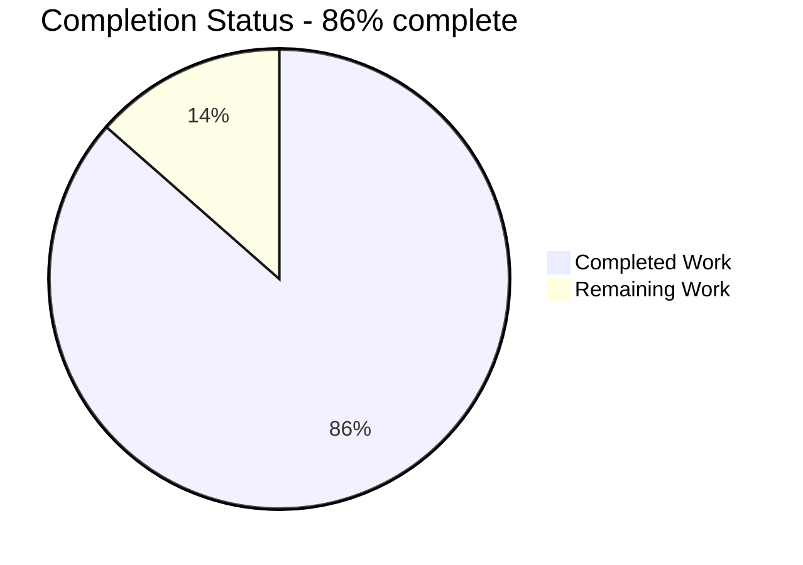
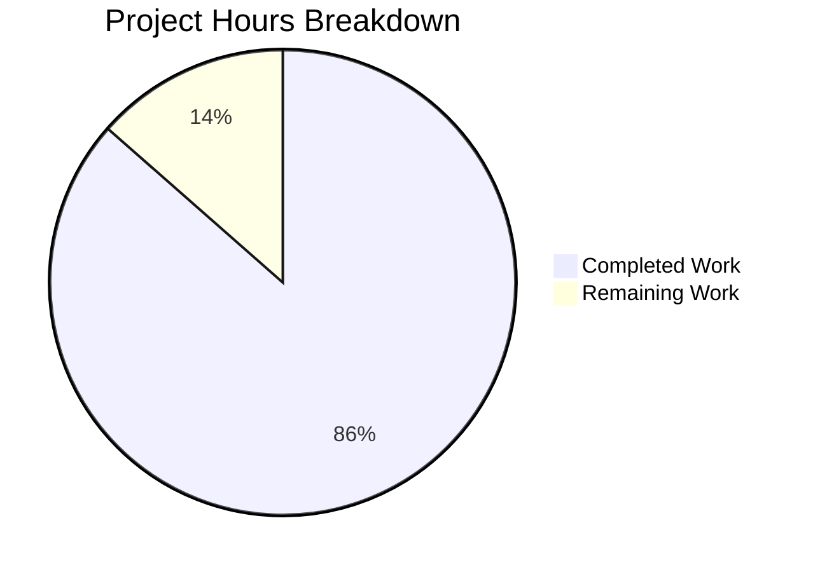
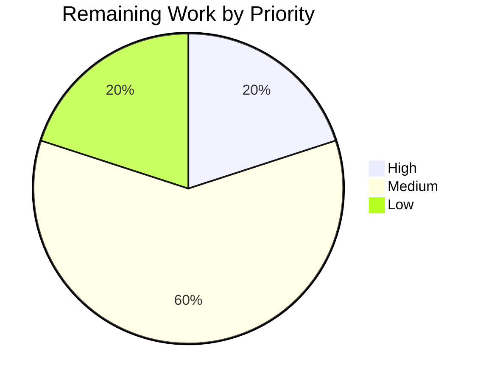

# 1. Executive Summary

## 1.1 Project Overview

A single-file Node.js HTTP server on the built-in `http` module alone, with no external dependency. It answers one route, falls through to a catch-all 404, validates its port, logs every request and shuts down cleanly on Ctrl+C. It exists to be read: server creation, request inspection, route matching, response writing, logging, configuration validation and shutdown all sit in one 153-line file, `server.js`, explained by a README a reader with no Node.js background can follow. The deliverable is those three files, with no build step, no install step and no third-party code.

## 1.2 Completion Status



| Metric | Hours |
|--------|-------|
| Total Hours | 37 |
| Completed Hours (AI + Manual) | 32 |
| Remaining Hours | 5 |

Chart shading: Completed = Dark Blue (#5B39F3); Remaining = White (#FFFFFF).

Completion is 32 of 37 hours — 32 / (32 + 5) × 100 = 86.5%, reported as **86%**. All 27 acceptance gates pass; the remaining hours are Section 1.4's four items, itemised in Section 2.2.

## 1.3 Key Accomplishments

- [x] `GET /hello` → 200 `text/plain` `Hello world`; anything else → 404 `Not Found`.
- [x] Path matching that ignores the query string: `/hello?x=1` served, `/hello/` not, raw URL logged.
- [x] `PORT`: default 3000, range 1024-65535, two-line refusal with exit status 1 before anything binds.
- [x] Clean lifecycle: one startup line, one ISO-8601 line per request, SIGINT exiting 0 with a live keep-alive client.
- [x] Actionable failures: an `EADDRINUSE` pair naming the port, exit 1, never internal detail in a response.
- [x] Zero dependencies in fact: one import, no dependency sections, no lockfile, no install step.
- [x] Manifest metadata exactly as specified, with a `scripts.start` that makes `npm start` work.
- [x] Documentation whose every published literal — both bodies, both refusal pairs, both shutdown lines, the header — matches actual output.

## 1.4 Critical Unresolved Issues

Four items remain open of the 27 acceptance gates and 14 functional requirements this work was scoped against — no requirement is undelivered and no gate fails.

| Issue | Impact | Owner | ETA |
|-------|--------|-------|-----|
| The response-stream failure line (`Request handling error: <message>`, `server.js:83`) has never been triggered; hundreds of aborted and reset clients produced no such event | One defensive diagnostic is unproven at runtime, though a breaking peer demonstrably cannot end the process | Backend developer | 2 h |
| `engines.node` is `">=18.0.0"`, a release line with no security patches since April 2025, and npm treats the field as advisory | A reader can run the tutorial on an unpatched runtime with no refusal at start-up | Project owner | 1 h |
| The listener binds every interface (`*:port`) and speaks plain HTTP with no authentication, TLS or rate limiting; the README does not state the bind scope | A reader may expect loopback-only; on a shared or untrusted network the server is reachable as delivered | Documentation owner | 1 h |
| The latency and memory figures were measured over minutes on an idle shared host rather than under sustained load | The two non-functional terms could move on a loaded host, though both passed with wide margin | QA engineer | 1 h |

## 1.5 Access Issues

No access issues identified. The project needs no credentials, no external service and no database; it opens no outbound connection and reads no file at runtime.

## 1.6 Recommended Next Steps

1. [High] Settle the declared runtime floor: accept `>=18.0.0` as written, or raise it and re-verify (1 h).
2. [Medium] Prove the response-stream failure diagnostic by inducing a write failure from outside the process (2 h).
3. [Medium] Re-measure the latency and memory terms under sustained load (1 h).
4. [Low] Add a README sentence stating the listener's default bind scope (1 h).

# 2. Project Hours Breakdown

## 2.1 Completed Work Detail

| Component | Hours | Description |
|-----------|-------|-------------|
| Server core — request listener, pathname matching, route table and dispatch, single response writer | 9 | `server.js:35-80, 131-132`: the frozen `ROUTES` table, exact case-sensitive pathname matching with the query stripped, the 404 fall-through that also answers a wrong method, and the one writer that sets status, `Content-Type` and body so the runtime computes `Content-Length` (11 and 9) |
| Port configuration and validation contract | 4 | `server.js:3-5, 16-33, 147-152`: `PORT` read once, default 3000 for unset or blank, the inclusive 1024-65535 range, the two-line diagnostics naming the received value, fail-fast with exit status 1 before any bind, and a range composed from the constants so it has one source of truth |
| Lifecycle, error handling and graceful shutdown | 5 | `server.js:86-129, 137-145`: the `EADDRINUSE` and generic listen-failure branches, the socket registry, the interrupt handler that drains tracked sockets, the unref'd 1-second failsafe, and exit statuses through `process.exitCode` on every path |
| Zero-dependency and security boundaries | 2 | `server.js:1, 49-53, 82-84`: a sole `require('node:http')`, no filesystem, evaluation, outbound network or persistence API anywhere, no request body read, fixed response bodies that never reflect input, and diagnostics confined to stderr |
| Manifest and npm launcher | 1 | `package.json`: the seven specified fields with their exact values, the `engines.node` floor and the load-bearing `scripts.start` that makes `npm start` run the server |
| README documentation | 4 | `README.md`: the eight topics in the required order, literal transcripts of every console line and response, copy-pasteable commands, and a configuration section covering the default, the range and a worked override |
| Acceptance verification | 6 | The whole request matrix, the nine-value rejection matrix with byte-exact stderr, both accepted range endpoints, the override, the `EADDRINUSE` and SIGINT gates with an idle keep-alive client, the launcher path, the documentation's fidelity to emitted bytes, and the three non-functional gates (0.44 ms average response, 100 concurrent requests all answered, bounded resident-memory plateau) |
| Code quality, comment discipline and static gates | 1 | Naming, formatting and structure review, the three-sanctioned-comment-site discipline, the placeholder sweep, and the dependency and import constraint checks |

**Total completed: 32 hours.** Each component traces to the requirements in Section 1.3; verification hours are counted here at roughly 38% of development hours, and the manifest's end-of-life declared floor is the one item carried forward as a decision rather than as work.

## 2.2 Remaining Work Detail

| Category | Hours | Priority |
|----------|-------|----------|
| Runtime-floor review at handover, and a floor raise with re-verification only if the requirement changes | 1 | High |
| Fault-injection proof of the response-stream failure diagnostic (`server.js:82-84`) | 2 | Medium |
| Sustained-load re-measurement of the latency and resident-memory terms | 1 | Medium |
| README sentence documenting the default bind scope of the listener | 1 | Low |
| **Total** | **5** | |

These four categories are the four open items of Section 1.4 and the only work outstanding. Nothing in the list is a deferred feature: the request excludes new endpoints, dependencies, tooling, containers, pipelines and persistence, so their absence is scope rather than remaining work, and the three-file deliverable is complete as specified.

# 3. Test Results

The server has no test framework and no test file: the request forbids adding the dependency one would need, so verification is the project's own gates, exercised against the running server from a shell. Every figure below was produced by running the delivered files on this machine — eleven server instances, 457 cases, 0 failures.

| Area / Category | Framework | Tests | Passed | Failed | Coverage | What This Proves |
|-----------------|-----------|-------|--------|--------|----------|------------------|
| Static syntax and dependency-constraint gate | `node --check`, npm, shell | 4 | 4 | 0 | n/a — no coverage tool is in scope | The file parses clean; the package declares no dependency and `node:http` is its only import |
| `PORT` configuration and validation | shell + `curl` against a running instance | 18 | 18 | 0 | All accepted and rejected forms the contract names | The port is defaulted, bounded, overridden and refused exactly as documented, with exit status 1 before anything binds |
| HTTP request contract | shell + `curl` | 8 | 8 | 0 | Every request form the contract names | `GET /hello` answers 200 `text/plain` `Hello world`; every other path and every other method answers 404 `Not Found` |
| Start-up and request logging | shell + console capture | 209 | 209 | 0 | 1 start-up line and 208 request lines, all conforming | One confirmation line follows a successful bind, and every handled request is logged once before routing with the raw URL |
| Response latency | `curl -w '%{time_starttransfer}'` | 100 | 100 | 0 | 100 sequential requests | `/hello` completes in 0.441 ms average and 0.977 ms maximum — far inside the 10 ms budget |
| Concurrent handling and resident memory | `curl` at 16-way concurrency, `/proc` sampling | 104 | 104 | 0 | 100 concurrent requests, 4 memory batches | Concurrency is not serialised (all 100 answered 200) and memory stays on a bounded plateau (58.2-59.8 MB) |
| Shutdown, port-in-use and launcher lifecycle | shell signals, `ss`, `npm` | 8 | 8 | 0 | Both exit paths and the launcher | Ctrl+C returns exit 0 with an idle keep-alive client connected, repeated signals still print one transcript, a busy port exits 1, and `npm start` launches the same server |
| Documentation fidelity | shell + `curl` | 6 | 6 | 0 | Every command and literal the README publishes | A reader following the README gets exactly the documented statuses, headers, bodies and console lines |

**Not Covered**

- **The response-stream failure diagnostic** (`Request handling error: <message>`, `server.js:82-84`). It was never observed: hundreds of abruptly closed and reset clients produced no such event, because an 11-byte determinate-length body leaves the socket in a single write. A human should induce a write failure from outside the process — a proxy that resets mid-response, or a throttled socket buffer — and confirm the line and its stream.
- **Node.js 18 itself.** Everything above was exercised on the Node.js release installed here (v22.23.4). The declared `>=18.0.0` floor rests on the fact that every API the code uses existed at 18.0.0 and that the two connection-closing helpers which post-date it are deliberately absent; a human who must support 18.x should run the same gate on that line.
- **Sustained load.** The latency and memory figures come from minutes-long runs on an idle host, not a multi-hour soak under production-like traffic.
- **Requests the HTTP parser rejects** (malformed framing, oversized headers). The runtime answers these itself with 400/431 and they never reach the application, so they produce no log line; confirm that this is the expectation for the runtime you deploy.
- **Signals other than SIGINT.** SIGTERM is not handled, so a process manager stops the server abruptly with no shutdown transcript; only Ctrl+C is contracted.
- **Client-side latency tails.** Under a saturated single client process, per-request round-trip time reached several milliseconds while the server's own first-byte time stayed below 1 ms; the difference is client contention, and a loaded host should be re-measured before any latency claim beyond this project's target is made.

# 4. Runtime Validation & UI Verification

Every item below was driven against a running instance of the delivered server (Node.js v22.23.4). The project has no user interface — no HTML, CSS, client JavaScript, form or cookie — so no browser session applies; the console and the HTTP responses are the entire observable surface.

- ✅ **Start-up and port binding** — one `Server listening on port <port>` line, printed once after the bind, across eleven instances: the default port 3000 and both range endpoints (1024 and 65535) bound inside an isolated network namespace, and eight host instances on override ports; nothing written to stderr on any start-up.
- ✅ **`GET /hello`** — `200`, `Content-Type: text/plain`, `Content-Length: 11`, body `Hello world`, with the documented header set and order.
- ✅ **Query string and trailing slash** — `GET /hello?x=1` served; `GET /hello/` a 404; the console line keeps the raw URL including the query string.
- ✅ **Catch-all and wrong method** — `/invalid`, `POST`, `PUT`, `OPTIONS` and `HEAD /hello` all answer 404 with the 9-byte body; no 405 anywhere; HEAD carries no body and no `Content-Length`.
- ✅ **Configuration failures** — nine invalid values (`abc`, `3000.5`, `-1`, `0x10`, `70000`, `65536`, `80`, `1023`, `0`) each exit 1 with exactly the two documented stderr lines naming the received value, and nothing on stdout.
- ✅ **Port already in use** — a second instance exits 1 with the `EADDRINUSE` pair naming the port while the first instance keeps serving.
- ✅ **Graceful shutdown** — SIGINT with an idle keep-alive client connected prints both shutdown lines once and exits 0; the port is released and a later request is refused.
- ✅ **npm launcher** — `npm start` prints npm's banner, then the start-up line, serves the endpoint and stops cleanly on the same signal.
- ⚠ **Response-stream failure diagnostic** — never produced at runtime, despite hundreds of deliberately aborted and reset clients; the behaviour it guards (a peer cannot end the process) held in every attempt.
- ⚠ **Node.js 18 and SIGTERM** — not exercised: the runtime installed here is v22.23.4, and only SIGINT is part of the contract, so a supervisor's SIGTERM stops the process without a shutdown transcript.

No external integration was exercised because none exists: the server opens no outbound connection, reads no file at runtime, persists nothing and depends on no third-party service or credential.

# 5. Compliance & Quality Review

## 5.1 Compliance Matrix

| Deliverable | Benchmark | Status | Evidence |
|-------------|-----------|--------|----------|
| `GET /hello` response contract | Contract fidelity — status, header value and body exactly as specified | ✅ Pass | `server.js:55-57, 71-72`; live 200, `Content-Type: text/plain`, 11-byte `Hello world` |
| Catch-all and wrong-method handling | Error-handling completeness — every unmatched path and method answered, never 405 | ✅ Pass | `server.js:76-79`; `/hello/`, `/invalid`, POST, PUT, OPTIONS and HEAD all 404 |
| Path matching and query handling | Input handling — pathname-only exact match, raw URL preserved in the log | ✅ Pass | `server.js:35-43, 64-71`; `/hello?x=1` served, `/hello/` not |
| Port configuration and validation | Configuration robustness — default, bounded range, actionable refusal, fail-fast before any bind | ✅ Pass | `server.js:16-33, 147-152`; nine rejected forms exit 1 with two stderr lines, both range endpoints bind |
| Graceful shutdown | Lifecycle robustness — bounded exit, status 0, sockets released with a live client | ✅ Pass | `server.js:97-129`; SIGINT with an idle keep-alive client: one transcript, exit 0, port released |
| Failure reporting and error hygiene | Security — no internal detail in any response, diagnostics confined to stderr | ✅ Pass | `server.js:49-53, 82-95`; bodies only the two constants, zero error text on stdout |
| Zero-dependency position | Supply-chain hygiene — no third-party code and no install step | ✅ Pass | `server.js:1` sole import; `package.json` has no dependency sections; no lockfile |
| Performance and resource behaviour | Non-functional terms — sub-10 ms response, non-serialised concurrency, bounded memory | ✅ Pass | 0.441 ms average / 0.977 ms maximum; 100 concurrent requests all answered; RSS plateau 58.2-59.8 MB |
| Manifest metadata and entry point | Build and run contract — specified fields with a working launcher | ✅ Pass | `package.json:1-9`; `npm start` reached `node server.js` and served the endpoint |
| Documentation accuracy | Documentation quality — eight topics whose published literals match real output | ✅ Pass | `README.md`; every documented line, header and body compared against emitted bytes |
| Code quality and structure | Maintainability — purpose-revealing names, one responsibility per function, comments only where logic is non-obvious, no placeholders | ✅ Pass | `server.js` 153 lines, nine comment lines at three sites, ten named responsibilities plus the wire-up |
| Runtime-floor disclosure | Release readiness — the runtime the deliverable advertises is a supported one | ⚠ Partial | `package.json:7`, `README.md:22`: `>=18.0.0` is an end-of-life line, fixed by the request and pending the owner's sign-off decision |

## 5.2 AAP & Rule Divergences and Gaps

| What the AAP/Rule Required | What Was Delivered Instead | Why It Diverged | Impact | Remediation |
|----------------------------|----------------------------|-----------------|--------|-------------|
| The shutdown sequence fixes a close callback that logs `Server closed.` and sets exit 0 (plan 0.5.1) | The callback does both only when the close reported no error (`server.js:106-111`) | The plan describes the successful path and never the error case; a close that did not happen must not be announced as one | None on the contract path — the transcript and exit 0 are unchanged; a process whose listening handle was never open prints one line and no second | None; keep as delivered (sanctioned settlement) |
| The assigned runtime restriction requires Node >= 20.20.2 on 20.x and >= 22.12.0 on 22.x | The declared floor remains the literal `">=18.0.0"` (`package.json:7`, `README.md:22`) | The request the plan serves fixes Node.js v18.0.0 as the minimum and the plan forbids raising or reinterpreting it; the restriction governs the runtime used to validate (v22.23.4) | The manifest advertises an end-of-life release line; no behaviour differs, since no API used post-dates 18.0.0 | Decide at sign-off; if the requirement changes, edit both files and re-run the start-up, override and range checks (sanctioned, needs human work — Section 2.2) |
| A linter or formatter gate over every changed file | Discharged as `node --check` plus pattern sweeps | Every linter and formatter is an external package the zero-dependency mandate excludes | Style compliance rests on inspection rather than tooling; all three files verified clean | None unless the zero-dependency constraint is relaxed (sanctioned) |
| The acceptance map names ports 3000 and 8080 for the override and default gates | The override ran on other free ports; the default-port cases ran with port 3000 bound only inside an isolated network namespace | Port 3000 is reserved for a single clone index on a shared host | None — the same code paths were exercised and the default value was verified literally in isolation | None (sanctioned) |
| Test artefacts co-located with the code | Probes were written outside the repository and removed after use | No test file may enter the deliverable under the zero-dependency mandate | The repository holds exactly the three planned files; the probe evidence is not shipped | None; the verification is reproducible from the commands in Sections 9 and 10 (sanctioned) |
| npm's canonical manifest formatting, as `npm pkg fix` would write it | The plan's inline field layout kept (`package.json:1-9`) | The plan's byte contract for the manifest outranks tooling output | Cosmetic only; `npm start` and `npm pkg get` behave identically | None (sanctioned) |

**D1 — the error-aware close callback.** The plan's shutdown sequence reads as an unconditional pair: the close callback logs `Server closed.` and sets `process.exitCode = 0` (plan 0.5.1). The delivered callback (`server.js:106-111`) takes the close's error argument and emits the line and the exit code only when the close reported no error, so a close that did not happen is no longer announced as one. The plan describes only the successful path, and that path is unchanged: every shutdown run, including one holding an idle keep-alive connection, prints `Shutting down server (SIGINT)...` then `Server closed.` and exits 0. Nothing is required of a human.

**D2 — the declared runtime floor.** The manifest declares `">=18.0.0"` (`package.json:7`) and the README repeats it in prose (`README.md:22`). The assigned runtime restriction requires Node 20.20.2 or newer on 20.x and 22.12.0 or newer on 22.x. The floor is deliberate: the request fixes Node.js v18.0.0 as the minimum and the plan forbids raising or reinterpreting it, while the runtime used for every gate (v22.23.4) satisfies both. The tutorial therefore advertises a release line with no security patches since April 2025, and npm treats `engines` as advisory, so nothing refuses to start on it. Section 2.2 carries the sign-off decision.

**D3 — the static quality gate.** The static quality gate provides for a linter or formatter pass over changed files; it was discharged with `node --check` plus pattern sweeps for forbidden APIs, placeholders and secrets, because every linter and formatter is an external package the project's zero-dependency mandate excludes. The practical effect is that style compliance — single quotes, two-space indentation, `camelCase` and `UPPER_SNAKE_CASE` naming, no trailing whitespace, no tabs, no CRLF, no unused identifiers — was established by reading all three files and by targeted sweeps rather than by a tool, and all three came back clean. No code change is warranted unless the dependency constraint is relaxed.

**D4 — the ports the acceptance gates name.** The acceptance map exercises the `PORT` override with the literal value 8080 and the default-port behaviour on 3000. The override was exercised on other free ports, and the default-port cases — unset, blank and whitespace-only `PORT` — with port 3000 bound only inside an isolated network namespace, since a shared host reserves that port for one clone index. Both verified the same behaviour: the resolution path, the startup line naming the resolved port, a 200 on `/hello`, a 404 on `/invalid` and exit status 0 on shutdown. The map's literal values are a plan convenience, not a contract term, so nothing in the deliverable is affected.

**D5 — where the probes live.** The verification probes are shell scripts and captures that cannot be committed: the request forbids adding a test framework, a runner or any test file, so they were written outside the repository and removed when their runs finished. The delivered tree therefore holds exactly the three planned files, with no test directory, no fixture and no lockfile. The effect on the reader is that the evidence is not shipped alongside the code — but every probe is reproducible from the commands in Sections 9 and 10, and each of the figures in Section 3 came from a command a reader can re-run against their own checkout.

**D6 — the manifest's byte layout.** The manifest keeps the plan's inline layout — `scripts`, `engines` and `keywords` on single lines (`package.json:1-9`) — rather than the expanded form npm's own tooling would write. The plan reproduces the manifest as a byte contract, and a byte contract outranks a tool's suggested reformatting. The difference is cosmetic: `npm start` resolves through the same `scripts.start`, `npm pkg get` returns the same seven values, and no behaviour depends on the layout. Nothing is required of a human, and reformatting the file would be a change without a benefit.

# 6. Risk Assessment

| Risk | Category | Severity | Probability | Mitigation | Status |
|------|----------|----------|-------------|------------|--------|
| The declared runtime floor (`>=18.0.0`) names a release line that has had no security patches since April 2025, and npm treats `engines` as advisory, so nothing refuses to start on it | Operational | Medium | High — it is a property of the manifest as delivered | Settle the floor at sign-off: accept it as the request words it, or raise it and re-verify the start-up, override and range gates | Open — owner decision |
| The listener binds every interface and speaks plain HTTP with no authentication, TLS or rate limiting | Security | Low | Medium — real on a shared or untrusted network | State the bind scope in the README; bind loopback only if the requirement changes | Accepted — the contract mandates the host-less bind |
| The request line records the raw URL, query string included, so a caller's own secret placed in a URL lands in the console or log sink | Security | Low | Low | Keep credentials out of query strings; the line's content is fixed by the contract | Accepted |
| If the reader of a piped stdout exits, a later console write surfaces as an unhandled stream error on stdout | Integration | Low | Low | Redirect stdout to a file or run under a supervisor that keeps the pipe open | Open — one listener would settle it |
| Requests the HTTP parser rejects (malformed framing, oversized headers) never reach the application and so produce no log line | Operational | Low | Low | Read "one line per request" as one line per request the application handles; the runtime answers these itself with 400/431 and no internal detail | Accepted |
| SIGTERM is not handled, so a process manager stops the server abruptly with no shutdown transcript | Operational | Low | Medium — likely behind any supervisor | Stop the server with Ctrl+C as documented; add a SIGTERM handler only if the requirement changes | Accepted — only SIGINT is contracted |
| The response-stream failure diagnostic (`server.js:82-84`) has never been triggered, so one defensive branch is unproven | Technical | Low | Low | Induce a write failure from outside the process and confirm the line and its stream (Section 2.2) | Open — 2 h |
| Resident memory does not return to its first-boot value over very long runs, although it is flat batch to batch and no per-request retention is evident | Technical | Low | Low | Re-measure over a multi-hour soak on a target-class host | Open — 1 h |

No integration risk appears beyond the console dependency above: the service makes no outbound call, reads no file at runtime, persists nothing and has no third-party dependency, so there is no vendor, credential, endpoint or schema failure mode to assess.

# 7. Visual Project Status





| View | Value |
|------|-------|
| Completed work | 32 h — 86% of the project |
| Remaining work | 5 h — 14% of the project |
| Remaining by category | Runtime-floor review 1 h (High) · response-stream diagnostic proof 2 h (Medium) · sustained-load re-measurement 1 h (Medium) · README bind-scope sentence 1 h (Low) |
| Chart shading | Completed = Dark Blue (#5B39F3); Remaining = White (#FFFFFF) |

The remaining work is handover-sized rather than feature-sized: three of the four categories are verification depth or a documentation sentence, and only the runtime-floor review asks for a decision rather than effort.

# 8. Summary & Recommendations

The project is delivered as three files at the repository root: `server.js`, a 153-line HTTP server on the built-in `node:http` module with no framework between the reader and the runtime; `package.json` with exactly the seven metadata fields the request fixes and a `scripts.start` that makes `npm start` launch the same entry point; and `README.md`, whose eight topics take a reader with no Node.js background from prerequisites through running, testing, expected output, shutdown and port configuration. The whole HTTP surface is one route and a catch-all 404, and the behaviour around it — port resolution and refusal, per-request logging, clean shutdown, actionable failures — is complete as specified. **86% of the AAP-scoped work is complete: 32 of 37 hours**, with every functional requirement delivered and all 27 acceptance gates passing.

What was exercised to prove it: 457 cases across eleven running instances, with no failures. The request matrix confirms 200/`text/plain`/`Hello world` for `GET /hello`, 404/`Not Found` for every other path and method, and the query-string and trailing-slash behaviour; the configuration matrix confirms the default, both range endpoints, an override, and nine rejected values that each exit 1 with the two documented stderr lines before anything binds; the lifecycle gates confirm exit status 0 on Ctrl+C even with an idle keep-alive client held open, one transcript for repeated signals, and the `EADDRINUSE` pair naming the port while the first instance keeps serving; and the three non-functional terms hold with margin — 0.441 ms average response against a 10 ms budget, 100 concurrent requests all answered, and a bounded resident-memory plateau. What is not covered is narrow and stated plainly in Section 3: the defensive response-stream line has never been triggered, Node.js 18 itself was not executed, and the performance figures come from minutes on an idle host rather than sustained load.

The critical path to production is short and, in one place, a decision. Four items remain, costing 5 hours in total: proving the response-stream diagnostic by inducing a write failure from outside the process; re-measuring the latency and memory terms under sustained load; adding one README sentence that states the default bind scope; and settling the declared runtime floor, which names a release line that has had no security patches since April 2025 while npm treats `engines` as advisory. Only that last item gates release as a judgement call rather than as work — everything else is verification depth or documentation polish, and the request itself excludes the usual production apparatus (no containers, pipelines, monitoring stack, persistence or authentication), so their absence is scope, not backlog.

Production readiness is therefore this: **ready for the target the request states — a single-process teaching HTTP server a developer starts from a terminal and stops with Ctrl+C** — and intentionally not a production service. It carries no dependency to patch, no file to read at runtime, no outbound connection, no state to corrupt and no input it reflects back; its failures are reported where an operator looks, and its shutdown is bounded. Deploying it beyond that target would change the product's purpose: a host-scoped bind, TLS, rate limiting and a signal other than SIGINT would each be new requirements, not defects to fix. Readiness for the stated target is complete; readiness for anything broader starts with the runtime-floor decision above.

# 9. Development Guide

## System Prerequisites

- **Node.js.** The manifest declares `engines.node` `">=18.0.0"` and the code uses no API newer than that, so any Node.js release at or above 18.0.0 runs it. Every command below was verified on **Node.js v22.23.4**.
- **npm** (11.21.0 verified here) — only for the optional `npm start` path.
- **curl** — for the documented request checks. No other tool is needed.
- No database, broker, cache, container or background service. Nothing is installed system-wide, no virtual environment is required, and no environment file is read.

```bash
node --version
npm --version
```

## Environment Setup and Dependency Installation

There is nothing to install and nothing to configure. The manifest declares no dependencies and no devDependencies, so there is no lockfile, no `node_modules` and no `npm install` step; the project has no build step, no bundler, no transpiler, no linter and no test framework.

```bash
cd /path/to/the/repository
npm pkg get dependencies devDependencies    # prints {} — there is nothing to install
node --check server.js                      # syntax gate: exits 0 with no output
```

`PORT` is the only configuration channel. It is read from the process environment once at start-up; no `.env` file, configuration file or command-line argument exists.

## Application Startup

```bash
node server.js                 # listens on port 3000 (the default)
PORT=8080 node server.js       # listens on 8080
PORT=8080 npm start            # the same, launched through the manifest
```

The server stays in the foreground and prints one confirmation line naming the port it actually bound:

```
Server listening on port 8080
```

`npm start` prints npm's own banner (`> nodejs-tutorial-hello-world@1.0.0 start`, `> node server.js`) before that line. Use any port from 1024 to 65535 that is free on your machine; pick a non-default one if 3000 is taken.

## Verification Steps

```bash
# the contract
curl http://localhost:3000/hello                     # Hello world
curl -i http://localhost:3000/hello                  # 200, Content-Type: text/plain, Content-Length: 11
curl -i http://localhost:3000/invalid                # 404, Not Found
curl -i -X POST http://localhost:3000/hello          # 404, Not Found
curl -i 'http://localhost:3000/hello?x=1'            # 200, Hello world
curl -I http://localhost:3000/hello                  # 404, no body and no Content-Length
```

On the server's console you should see one line per request, printed before the response, in the form `<ISO-8601 UTC timestamp> <METHOD> <raw url>`, for example:

```
2026-10-30T09:29:00.418Z GET /hello
2026-10-30T09:29:00.426Z GET /invalid
```

Stop the server with Ctrl+C (or `kill -INT <pid>`). It prints both shutdown lines and exits with status 0, even if a keep-alive client is still connected:

```
Shutting down server (SIGINT)...
Server closed.
```

Afterwards the port is free and a request is refused (`curl` exits 7).

## Example Usage

```bash
$ PORT=8080 node server.js
Server listening on port 8080
2026-10-30T09:29:00.418Z GET /hello
2026-10-30T09:29:00.426Z GET /invalid
Shutting down server (SIGINT)...
Server closed.
```

with, in a second terminal:

```bash
$ curl -i http://localhost:8080/hello
HTTP/1.1 200 OK
Content-Type: text/plain
Connection: keep-alive
Keep-Alive: timeout=5
Content-Length: 11

Hello world
```

Note that response bodies never appear on the console: `Hello world` and `Not Found` leave only over HTTP, while the console carries the start-up line, one request line each and the two shutdown lines.

## Troubleshooting

| Symptom | Cause and resolution |
|---------|----------------------|
| `Failed to start server: port 3000 is already in use (EADDRINUSE).` and exit status 1 | Something else holds the port. Start on another one (`PORT=8080 node server.js`) or stop the process using it. The message names the port it could not bind. |
| `Configuration error: PORT must be an integer between 1024 and 65535 (received "…").` and exit status 1 | `PORT` was not a plain integer in the accepted range. Nothing was bound; set a value such as 8080, or unset `PORT` to get the default 3000. Ports below 1024 are refused because they are privileged. |
| `node --check server.js` fails | A syntax error was introduced; the command prints the offending location and the error, and the file is the whole application, so there is nothing else to inspect. |
| Fewer console lines than requests | The runtime rejects malformed framing and oversized headers itself, with its own 400/431, before the application sees them; those requests are deliberately not logged. The log contract is one line per request the application handles. |
| The server keeps running after the terminal closed | The process was left in the background, or a signal other than SIGINT (such as SIGTERM from a supervisor) was sent — only SIGINT is handled, so SIGTERM ends the process without the shutdown transcript. Stop it with `kill -INT <pid>`. |
| `npm start` reports exit code 130 after Ctrl+C | npm's own accounting of the interrupt; the server process itself exits 0. Use `node server.js` directly if the exit code matters to a script. |
| A response body never shows on the console | Expected — bodies are written only to the HTTP response. |

There is no test suite inside the repository, and none may be added: the project has no test framework, no runner and no test file by design. The commands above are its verification mechanism, and each one was executed against this code.

# 10. Appendices

## A. Command Reference

| Command | Purpose | Expected result |
|---------|---------|-----------------|
| `node --check server.js` | Syntax gate over the whole application | Exit 0, no output |
| `node server.js` | Run on the default port | `Server listening on port 3000` |
| `PORT=<port> node server.js` | Run on a chosen port | `Server listening on port <port>` |
| `PORT=<port> npm start` | Run through the manifest's `scripts.start` | npm banner, then the start-up line |
| `curl http://localhost:<port>/hello` | Happy-path check | `Hello world` |
| `curl -i http://localhost:<port>/hello` | Status and headers | `200`, `Content-Type: text/plain`, `Content-Length: 11` |
| `curl -i http://localhost:<port>/invalid` | Catch-all check | `404`, `Content-Length: 9`, `Not Found` |
| `curl -i -X POST http://localhost:<port>/hello` | Wrong-method check | `404`, `Not Found` (never 405) |
| `curl -I http://localhost:<port>/hello` | HEAD check | `404`, no body, no `Content-Length` |
| `curl -s -w '%{time_starttransfer}\n' -o /dev/null http://localhost:<port>/hello` | Per-request first-byte time | Well under 10 ms |
| `kill -INT <pid>` | Graceful shutdown | Both shutdown lines, exit status 0 |
| `npm pkg get name version description main scripts.start engines.node keywords` | Manifest verification | The seven specified values |
| `npm pkg get dependencies devDependencies` | Dependency check | `{}` |
| `grep -n "require(" server.js` | Import check | Only `require('node:http')` |

## B. Port Reference

| Port or range | Behaviour |
|---------------|-----------|
| unset, blank or whitespace-only `PORT` | Binds 3000 |
| 1024-65535 inclusive | Binds that port |
| below 1024, above 65535, or not a plain integer | Refused with the two-line diagnostic on stderr and exit status 1, before anything binds |
| 8080 | An example used in the project's own guidance messages; no special meaning |
| any port in use | Reported as `EADDRINUSE` with the port named, exit status 1 |

The listener binds every interface of the host, not loopback only, because the server is started with no host argument; see the risk table in Section 6.

## C. Key File Locations

| Path | Role |
|------|------|
| `server.js` | The entire application: constants (3-9), `resolvePort()` (16-33), `getPathname()` (35-43), `logRequest()` (45-47), `sendTextResponse()` (49-53), `handleHelloRequest()` (55-57), the frozen `ROUTES` table (59-61), `handleRequest()` (63-80), `handleStreamError()` (82-84), `handleServerError()` (86-95), `shutdown()` (97-129) and the wire-up (131-153) |
| `package.json` | The seven metadata fields, the `engines.node` floor and `scripts.start` |
| `README.md` | Purpose, prerequisites, installation, running, testing, expected output, stopping and configuration |

The repository holds exactly these three files. Adding an endpoint means adding one entry to the `ROUTES` table at `server.js:59-61`; dispatch, logging and response writing need no change.

## D. Technology Versions

| Technology | Version | Notes |
|------------|---------|-------|
| Node.js | `>=18.0.0` declared; **v22.23.4** used for every verification in this guide | No API newer than 18.0.0 is used; the connection-closing helpers that post-date that floor are deliberately absent |
| npm | 11.21.0 | Used only to launch the server and inspect the manifest |
| HTTP | HTTP/1.1 over TCP | Plain HTTP, no TLS, no HTTP/2 |
| Runtime dependencies | none | Sole import: `node:http` |
| Build, lint and test tooling | none | Excluded by the zero-dependency constraint |

## E. Environment Variable Reference

| Variable | Required | Accepted values | Effect |
|----------|----------|-----------------|--------|
| `PORT` | No | An integer from 1024 to 65535; unset or blank means 3000 | The port the server binds. Read once at start-up; any other value produces the configuration error and exit status 1 |

No other environment variable is read. There is no `.env` file, no configuration file and no command-line argument parsing.

## F. Developer Tools Guide

| Tool | Use here |
|------|----------|
| `node` | Run the server and the syntax gate |
| `npm` | Launch through `scripts.start` and inspect manifest fields |
| `curl` | Check statuses, headers, bodies and per-request timing (`-i`, `-I`, `-X`, `-w '%{time_starttransfer}'`) |
| `ss` / `lsof` | Confirm which process owns a port (`ss -ltnp 'sport = :3000'`, `lsof -ti :3000`) |
| `/proc/<pid>/status` | Sample resident memory (`awk '/^VmRSS/{print $2}'`) |
| `kill -INT` / Ctrl+C | Send the shutdown signal the server handles |

No linter, formatter, bundler, test runner or coverage tool is part of this project, and none may be added without breaking its zero-dependency property; `node --check` plus the commands above are the intended toolchain.

## G. Glossary

| Term | Meaning here |
|------|--------------|
| Contract literal | A string the server must emit exactly: the start-up line, the request line, both response bodies, the header value, both refusal pairs and both shutdown lines |
| Catch-all | The single 404 path that answers every request the route table does not match, including a wrong method on a matched path |
| Route table | The frozen `ROUTES` map at `server.js:59-61`, keyed by pathname with the method it answers and the handler that writes the response |
| Failsafe timer | The unref'd one-second timer armed during shutdown that destroys any socket still open, so a stalled peer cannot hold the process |
| Keep-alive | A client connection reused for further requests; an idle one is why shutdown tracks sockets rather than only closing the listener |
| `EADDRINUSE` | The error code reported when the chosen port is already bound by another process |
| SIGINT | The interrupt signal sent by Ctrl+C; the only signal this server handles |
| ISO-8601 timestamp | The UTC form produced for each request line, e.g. `2026-10-30T09:29:00.418Z` |
| `engines` | The manifest field declaring the Node.js versions the package supports; npm treats it as advisory |
| Zero-dependency | The property that the project imports only Node.js built-ins and declares no external package, so there is no install step and no dependency to patch |
